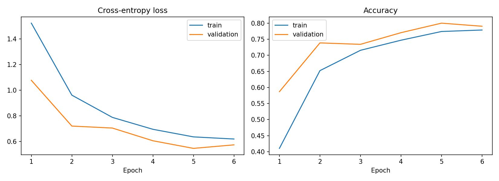
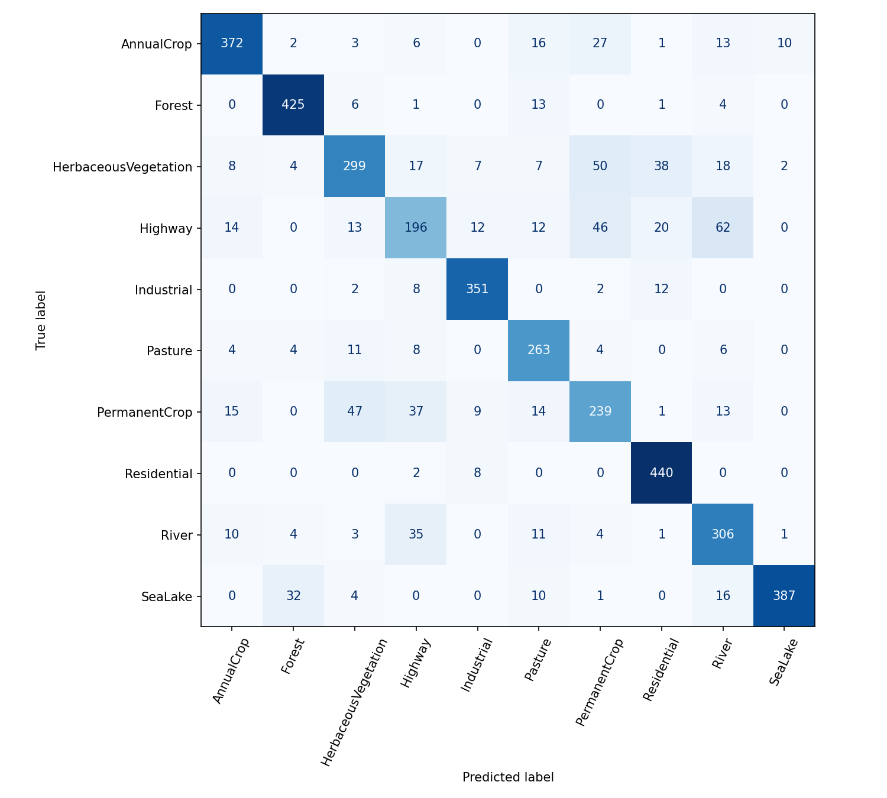
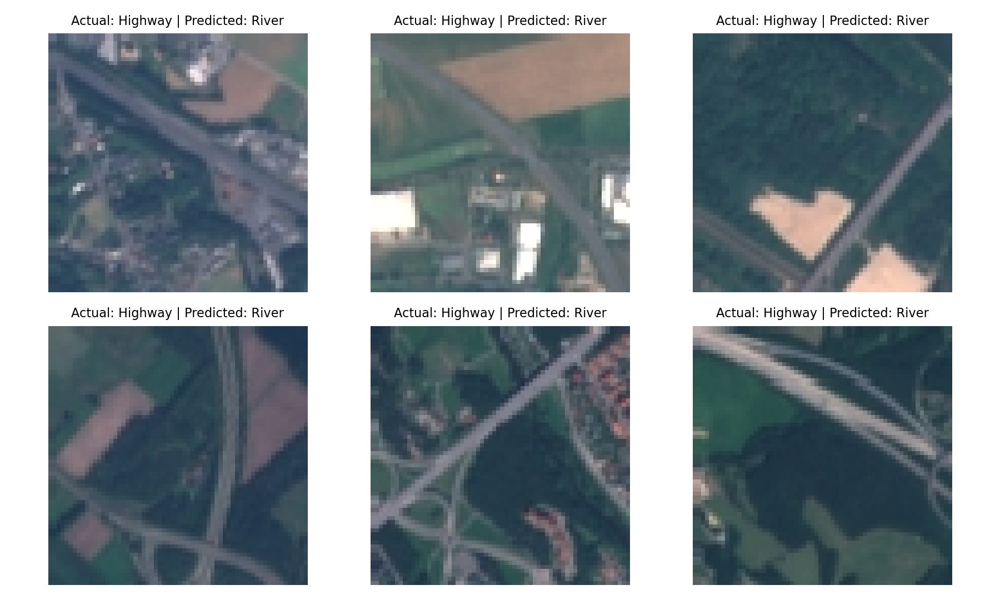

# Sentinel-2 RGB Land-Cover Classification | EuroSAT

An educational **Earth Observation + machine learning** project to classify 10 land-cover classes from 64 × 64 Sentinel-2 **RGB** image patches using PyTorch. This is a reproducible portfolio experiment, **not** an operational land-cover mapping system or a state-of-the-art benchmark.

## Results — Google Colab run, 23 November 2026

| Metric | Value |
|---|---:|
| Dataset | EuroSAT RGB |
| Images / classes | 27,000 / 10 |
| Training / validation / test | 18,900 / 4,050 / 4,050 |
| Best validation accuracy | **80.02%** (epoch 5/6) |
| Held-out test accuracy | **80.94%** (3,278 / 4,050) |
| Macro F1 score | **0.801** |
| Trainable parameters | 1,143,242 |

**Error-analysis finding:** 62 of 375 actual Highway test patches were classified as River; Highway recall was 52.3%. Reviewing a sample of those errors suggests that elongated road patterns might be mistaken for river-like structures, but the cause has **not** been established experimentally.

## Approach

- **Dataset:** [EuroSAT RGB via TorchVision](https://pytorch.org/vision/stable/generated/torchvision.datasets.EuroSAT.html), 10 classes of satellite image patches (only RGB, not all Sentinel-2 spectral bands).
- **Split:** random stratified 70/15/15, seed 42. Train, validation, and test images are disjoint by dataset index.
- **Augmentation:** random horizontal/vertical flips on training data only.
- **Network:** custom CNN with three convolution/ReLU/max-pooling blocks, a fully connected head and dropout.
- **Training:** PyTorch, Adam with learning rate 0.001, cross-entropy loss, six epochs.
- **Model selection:** keep the checkpoint with best validation accuracy; evaluate on the held-out test split only after checkpoint selection.
- **Analysis:** per-class precision, recall, F1, confusion matrix, and qualitative review of Highway → River misclassifications.

## Figures





## Run

1. Open `EuroSAT_Land_Cover_Classification.ipynb` in [Google Colab](https://colab.research.google.com/).
2. Run notebook cells sequentially. The notebook downloads EuroSAT to a local `data/` directory.
3. A GPU is optional; the reported run used CPU. Time and exact scores may vary with software or hardware versions.
4. Generated figures, class metrics, and model checkpoint are available in `results/` and `models/` when committed.

The saved notebook is a clean reproducible notebook without original execution outputs. The reported metrics and images are from a completed Colab run, not fabricated benchmark values.

## Repository layout

```text
EuroSAT_Land_Cover_Classification.ipynb
README.md
MODEL_CARD.md
requirements.txt
models/eurosat_best_cnn.pt
results/eurosat_training_curves.png
results/eurosat_confusion_matrix.png
results/eurosat_error_analysis.png
results/results_summary.txt
```

## Limitations

A **random patch split is not a geographically independent validation**: similar imagery from related regions may make performance more optimistic than a new-region deployment. RGB-only input and a lightweight architecture also limit performance. This is not operational mapping and the test result should not be used to claim generalization to unseen geography.

Potential follow-ups: a stronger baseline or transfer learning, careful assessment of spatial independence, and analysis of class-specific mistakes. Do not tune to the held-out test set.

## Attribution

Dataset source: [EuroSAT on Zenodo](https://zenodo.org/records/7711810), accessed through TorchVision. The 27,000 original images are **not redistributed** here.

## One-line project summary

> Built a PyTorch CNN for 10-class Sentinel-2 RGB land-cover classification on EuroSAT (80.94% held-out test accuracy) and performed class-level error analysis.
